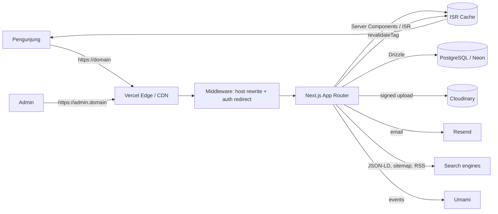
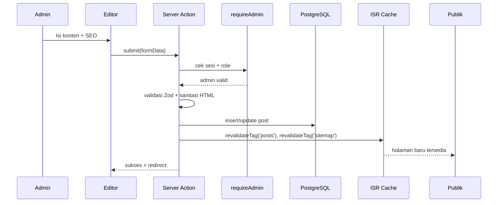
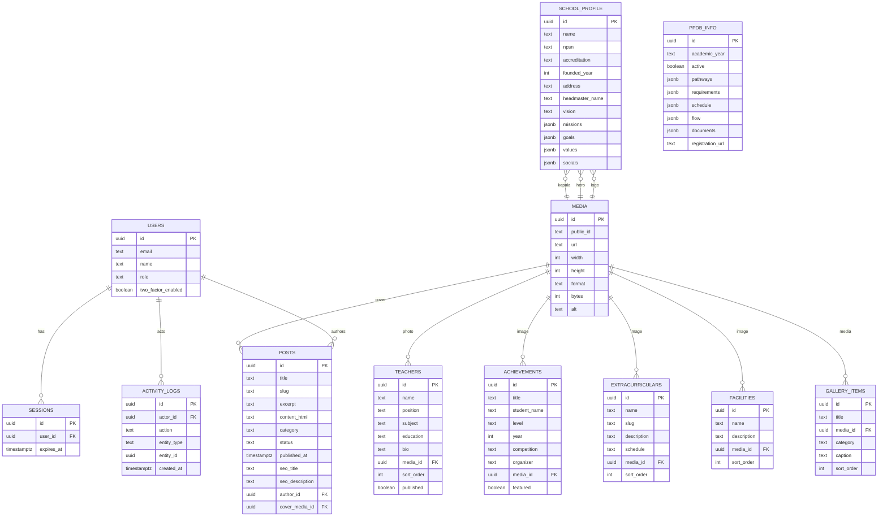

# SMP Negeri 2 Ambulu — Blueprint Landing Page, CMS Admin, dan SEO

> **Status:** DRAFT blueprint. UI landing page sudah diimplementasikan sebagai pratinjau; admin/CMS belum.
> **Tanggal:** 2026-11-14
> **Stack inti:** Next.js 16 App Router, TypeScript, Tailwind CSS v4, PostgreSQL, Drizzle ORM, Better Auth, Cloudinary, Vercel.
> **Prinsip:** SEO-first, server-rendered, satu role admin, motion secukupnya, data sekolah tidak dikarang.
> 
> **Backend v1 (diimplementasikan):** SQLite + Drizzle untuk lokal/VPS, auth sesi opaque (scrypt), admin `/admin`, modul Guru, Berita, Prestasi, dan CRM Kritik & Saran (Telegram opsional). Blueprint §8–§9 menyebut PostgreSQL/Better Auth; itu target produksi, bukan implementasi saat ini.
>
> **Design v3 (diimplementasikan):** palet putih/cream–hitam–matcha; **Poppins** untuk display/label, **Source Sans 3** untuk body/UI dan aksen italic; tanpa glassmorphism dan tanpa Three.js. Motion: opening intro collage 8 foto, mask reveal, parallax, marquee, rail, lightbox, album hero, dan flip card guru. Halaman `/guru` sudah tersedia. Bagian §0/§7 di dokumen ini adalah blueprint awal; implementasi mengikuti v3 dan `README.md`.

---

## 0. Keputusan inti

| Area | Keputusan | Alasan |
|---|---|---|
| Website publik | SEO-oriented, Server Components + ISR, tanpa login link | Kecepatan, crawlability, kepercayaan institusi |
| Admin | Host terpisah `admin.<domain>`, satu role `admin`, tanpa registrasi publik | Permukaan serangan kecil; publik tidak melihat pintu masuk |
| Model konten | Structured content, bukan page builder | Konten terkontrol, SEO konsisten, admin tidak bisa merusak layout |
| Visual | Corporate calm matcha: putih/cream, hitam, matcha; Poppins + Source Sans 3; serif tidak dipakai | Profesional, tegas, tidak dekoratif berlebihan |
| Motion | Opening intro, mask reveal, parallax, marquee, rail, lightbox | Motion terasa disengaja, bukan template animasi |
| 3D | Tidak ada 3D pada implementasi v2 | Fokus pada tipografi, foto, dan ritme scroll |
| Database | PostgreSQL + Drizzle | Relasional, migrasi jelas, query terkontrol |
| Auth | Better Auth: email/password, TOTP 2FA, sesi database | Tidak menulis auth sendiri; satu admin tetapi aman |
| Media | Cloudinary + adapter `MediaStore` | Transformasi gambar, CDN, upload dari HP |
| Hosting | Vercel + Neon | ISR dan preview deployment tanpa ops; ada fallback VPS |
| Bahasa | Bahasa Indonesia; tanpa i18n | Fokus SEO lokal dan konsistensi copy |

---

## 1. Tujuan, non-goals, anti-goals

### 1.1 Tujuan

1. Menjadi wajah digital resmi SMP Negeri 2 Ambulu yang kredibel, cepat, dan mudah ditemukan.
2. Menjelaskan identitas, profil, akademik, fasilitas, ekstrakurikuler, prestasi, guru, dan SPMB/PPDB dalam satu pengalaman yang koheren.
3. Memberi admin non-teknis kemampuan memperbarui konten tanpa developer.
4. Menghasilkan struktur teknis SEO yang benar sejak awal: metadata, canonical, sitemap, structured data, internal linking, dan performa.
5. Menjadi aset jangka panjang: desain tidak lekang oleh tren, kode mudah dirawat, konten mudah dipindahkan.

### 1.2 Non-goals

- LMS, e-learning, bank soal, atau portal siswa.
- Sistem informasi sekolah (SIS), absensi, rapor, pembayaran.
- Pendaftaran SPMB/PPDB online di dalam sistem ini; sistem hanya mengarahkan ke kanal resmi.
- Multi-sekolah, multi-tenant, atau multi-role.
- Registrasi publik, komentar publik, user-generated content.
- E-commerce, donasi online, atau pembayaran.
- Page builder bebas; admin mengedit konten terstruktur.
- Pencarian internal dan i18n pada rilis pertama.
- Toggle dark mode publik.

### 1.3 Anti-goals

- 3D/glass yang membuat LCP buruk, jank di Android mid-range, atau teks sulit dibaca.
- Tombol login di landing page, tautan admin di footer, atau admin yang terindeks.
- Data faktual karangan: NPSN, akreditasi, alamat, prestasi, nama siswa/guru harus berasal dari sekolah.
- Halaman tipis demi keyword; lebih baik satu halaman kuat daripada sepuluh halaman doorway.
- Animasi yang menghalangi konten atau tidak bisa dimatikan.

### 1.4 Ukuran keberhasilan

| Metrik | Target |
|---|---|
| Lighthouse mobile — Performance | ≥ 90 |
| Lighthouse mobile — SEO | 100 |
| Lighthouse mobile — Accessibility | ≥ 95 |
| Lighthouse mobile — Best Practices | ≥ 95 |
| LCP (4G, mobile) | ≤ 2,5 s |
| CLS | ≤ 0,1 |
| INP | ≤ 200 ms |
| JS awal halaman publik | ≤ 180 KB gzip, di luar chunk 3D lazy |
| Waktu admin publish artikel | ≤ 5 menit dari login |
| Organic search | Pertumbuhan impresi/klik dalam 3–6 bulan, bukan janji ranking |
| Insiden kritis | 0 pada auth, upload, dan kebocoran data |

---

## 2. Aktor dan journey

| Aktor | Kebutuhan utama |
|---|---|
| Calon siswa / orang tua | Apakah sekolah ini layak? Bagaimana cara masuk? Berapa biaya? Di mana? |
| Siswa aktif | Info kegiatan, prestasi, jadwal, pengumuman |
| Alumni | Berita, galeri, prestasi, kontak |
| Masyarakat / mitra | Profil sekolah, fasilitas, kontak resmi |
| Admin sekolah | Mengubah konten dengan cepat, aman, tanpa merusak layout |
| Mesin pencari | HTML server-rendered, metadata, structured data, sitemap, URL stabil |

### 2.1 Journey utama

**Calon orang tua dari Google**
`search "SMPN 2 Ambulu PPDB"` → beranda → `PPDB/SPMB` → syarat & jadwal → WhatsApp panitia.

**Orang tua menilai sekolah**
Beranda → prestasi → fasilitas → guru → berita → kontak.

**Alumni**
Berita → galeri → prestasi → sosial media.

**Admin**
`admin.<domain>` (diketik manual) → login + TOTP → dashboard → buat berita → preview → publish → revalidasi → live.

---

## 3. Kebutuhan fungsional

| ID | Kebutuhan | Prioritas | Kriteria terima |
|---|---|---|---|
| FR-01 | Beranda dinamis dari konten admin | Must | Menampilkan hero, profil singkat, visi, program, prestasi, guru, berita, galeri, CTA SPMB |
| FR-02 | Halaman profil dan sejarah | Must | Ada TOC, timeline, sambutan kepala sekolah, foto |
| FR-03 | Halaman visi, misi, tujuan, nilai | Must | Dapat diedit sebagai daftar terurut |
| FR-04 | Halaman akademik | Must | Kurikulum, program unggulan, pembiasaan, sistem pembelajaran, program pendukung |
| FR-05 | Halaman fasilitas | Must | Daftar fasilitas dengan foto, deskripsi, urutan |
| FR-06 | Ekstrakurikuler index + detail | Must | Filter, halaman detail dengan jadwal, deskripsi, prestasi |
| FR-07 | Prestasi dengan filter tahun/tingkat | Must | Filter, unggulan, foto opsional, nama siswa hanya jika ada consent |
| FR-08 | Direktori guru dan tenaga kependidikan | Must | Filter bidang, foto, jabatan, pendidikan, bio singkat |
| FR-09 | Blog/berita index + detail | Must | Slug, kategori, cover, konten kaya, SEO field, draft/publish |
| FR-10 | Galeri dengan lightbox | Should | Filter kategori, caption, alt, keyboard navigation |
| FR-11 | Halaman SPMB/PPDB | Must | Jalur, syarat, jadwal, alur, dokumen, biaya, kontak, link resmi, FAQ, tanggal update |
| FR-12 | Kontak dan sosial media | Must | NAP konsisten, WhatsApp, email, Maps click-to-load, social links |
| FR-13 | Admin login terpisah, satu role | Must | Tanpa registrasi; redirect jika belum login; 2FA; rate limit |
| FR-14 | CRUD konten terstruktur | Must | Guru, berita, prestasi, ekstrakurikuler, fasilitas, galeri, profil, SPMB |
| FR-15 | Media library | Must | Upload, alt wajib, ukuran/format validasi, cegah hapus jika dipakai |
| FR-16 | Draft, preview, publish, revalidate | Must | Preview hanya admin; publish memicu revalidasi tag |
| FR-17 | SEO teknis | Must | Metadata, canonical, OG, sitemap, robots, JSON-LD, RSS |
| FR-18 | Pencarian/filter/sort di admin | Should | Cari judul/nama, filter status/kategori, sort, pagination |
| FR-19 | Activity log | Should | Login, create, update, delete, publish, settings |
| FR-20 | Export konten | Could | JSON export untuk backup/migrasi |
| FR-21 | Reduced motion & fallback 3D | Must | Konten tetap lengkap tanpa WebGL/animasi |
| FR-22 | Responsif 375–1440+ | Must | Tidak ada horizontal scroll yang tidak disengaja; target sentuh 44px |

---

## 4. Kebutuhan non-fungsional

| ID | Kategori | Target |
|---|---|---|
| NFR-01 | Performance | Budget di §1.4; 3D lazy; gambar AVIF/WebP; JS minimal |
| NFR-02 | Accessibility | WCAG 2.2 AA; kontras 4.5:1; fokus terlihat; keyboard; alt; reduced motion |
| NFR-03 | SEO | HTML server-rendered; metadata unik; structured data valid; URL stabil; 301 |
| NFR-04 | Security | Auth kuat, 2FA, rate limit, sanitasi, CSP, least privilege, audit |
| NFR-05 | Privacy | Consent foto/nama; kebijakan privasi; data minimization |
| NFR-06 | Reliability | Backup harian; restore drill; uptime monitoring |
| NFR-07 | Maintainability | TypeScript strict; Zod; tests; dokumentasi; satu pola arsitektur |
| NFR-08 | Compatibility | Chrome/Edge/Firefox/Safari 2 versi terakhir; iOS 16+; Android Chrome |
| NFR-09 | Observability | Error tracking, analytics, Web Vitals, log admin |
| NFR-10 | Portability | Export data; adapter media; fallback VPS |

---

## 5. Information architecture dan routes

### 5.1 Navigasi publik

Header maksimal 5 item + 1 CTA:

1. **Profil** — Sejarah, Visi & Misi, Guru, Fasilitas
2. **Akademik** — Program, Ekstrakurikuler
3. **Prestasi**
4. **Berita**
5. **SPMB**
6. CTA: **Hubungi kami** atau **Info SPMB**

Footer memuat seluruh route, kontak, sosial, kebijakan privasi. **Tidak ada link login/admin.**

### 5.2 Route publik

| Route | Halaman | Rendering | Index | Catatan |
|---|---|---|---|---|
| `/` | Beranda | ISR 300 s + tag | Ya | LCP dioptimalkan |
| `/profil` | Profil singkat | ISR 3600 s | Ya | Ringkasan + TOC |
| `/profil/sejarah` | Sejarah & filosofi | ISR 3600 s | Ya | Timeline |
| `/profil/visi-misi` | Visi, misi, tujuan, nilai | ISR 3600 s | Ya | Manifesto tipografis |
| `/profil/sambutan` | Sambutan kepala sekolah | ISR 3600 s | Ya | Foto + surat |
| `/akademik` | Akademik | ISR 3600 s | Ya | Bento program |
| `/fasilitas` | Fasilitas | ISR 3600 s | Ya | Bento foto |
| `/ekstrakurikuler` | Index ekstrakurikuler | ISR 600 s | Ya | Filter |
| `/ekstrakurikuler/[slug]` | Detail ekstrakurikuler | ISR 600 s + tag | Ya | Jadwal, prestasi |
| `/prestasi` | Arsip prestasi | ISR 300 s | Ya | Filter tahun/tingkat |
| `/guru` | Guru & tenaga kependidikan | ISR 3600 s | Ya | Direktori |
| `/berita` | Index berita | ISR 300 s + tag | Ya | Magazine layout |
| `/berita/[slug]` | Artikel | ISR 3600 s + tag | Ya | `NewsArticle` |
| `/ppdb` | SPMB/PPDB | ISR 300 s | Ya | Canonical untuk pencarian PPDB |
| `/galeri` | Galeri | ISR 600 s | Ya | Masonry + lightbox |
| `/kontak` | Kontak | ISR 3600 s | Ya | NAP + Maps facade |
| `/kebijakan-privasi` | Kebijakan privasi | ISR 86400 s | Ya | Consent & data |
| `/sitemap.xml` | Sitemap | Dynamic cache | — | Hanya konten published |
| `/robots.txt` | Robots | Static | — | Disallow admin/API/preview |
| `/berita/rss.xml` | RSS | Dynamic cache | — | Feed berita |

### 5.3 Route admin (host terpisah)

| Route internal | Fungsi |
|---|---|
| `/admin/masuk` | Login + TOTP |
| `/admin` | Dashboard |
| `/admin/profil` | Editor singleton profil sekolah (tab) |
| `/admin/berita` | List, filter, create |
| `/admin/berita/baru` | Editor berita |
| `/admin/berita/[id]` | Edit berita |
| `/admin/guru` | CRUD guru |
| `/admin/prestasi` | CRUD prestasi |
| `/admin/ekstrakurikuler` | CRUD ekstrakurikuler |
| `/admin/fasilitas` | CRUD fasilitas |
| `/admin/galeri` | CRUD galeri |
| `/admin/ppdb` | Editor SPMB/PPDB |
| `/admin/media` | Media library |
| `/admin/pengaturan` | SEO default, sosial, analytics, banner |
| `/admin/aktivitas` | Activity log |
| `/admin/keamanan` | Password, 2FA, sesi, recovery codes |

Host `admin.<domain>` me-rewrite ke route group admin. Publik tidak pernah menautkan host ini.

### 5.4 Strategi cache dan revalidasi

- Halaman publik: Server Components + ISR.
- Tag: `profile`, `teachers`, `posts`, `post:<slug>`, `achievements`, `extracurriculars`, `facilities`, `gallery`, `ppdb`, `sitemap`.
- Setelah mutation: `revalidateTag(...)` + `revalidatePath(...)` dari satu fungsi `revalidateContent()`.
- Preview draft: `draftMode()` + cek sesi admin; tidak masuk cache.
- Sitemap/RSS memakai tag yang sama agar ikut segar.
- Jangan cache halaman admin, API auth, atau preview.

---

## 6. Blueprint halaman

Prinsip layout: **tidak ada tiga kartu identik berturut-turut**. Gunakan grid 12 kolom dengan span asimetris (7/5, 5/7, 4/8), full-bleed, sticky label, rail horizontal, dan jeda besar. Setiap halaman punya satu “signature layout”.

### 6.1 Beranda

```text
┌──────────────────────────────────────────────────────────────┐
│  LOGO        Profil   Akademik   Prestasi   Berita   SPMB  → │
├──────────────────────────────────┬───────────────────────────┤
│  SMP NEGERI 2 AMBULU             │                           │
│  Ruang tumbuh generasi           │   foto sekolah            │
│  yang berpikir jernih.           │   + kanopi WebGL          │
│  [Kenali sekolah] [Info SPMB]    │   [glass stat strip]      │
├──────────────────────────────────┴───────────────────────────┤
│  01 / PROFIL        teks besar, label sticky di kiri         │
├──────────────────────────────────────────────────────────────┤
│  VISI & MISI        section gelap, daftar bernomor           │
├──────────────────────────────────────────────────────────────┤
│  AKADEMIK           bento 7/5 + 4/4/4                        │
├──────────────────────────────────────────────────────────────┤
│  PRESTASI           rail horizontal + filter tahun/tingkat   │
├──────────────────────────────────────────────────────────────┤
│  GURU               portrait wall 4 kolom                    │
├──────────────────────────────────────────────────────────────┤
│  BERITA             featured 7 kolom + 2 list 5 kolom        │
├──────────────────────────────────────────────────────────────┤
│  GALERI             full-bleed rail                          │
├──────────────────────────────────────────────────────────────┤
│  SPMB               accent band + 3 langkah + CTA            │
├──────────────────────────────────────────────────────────────┤
│  FOOTER             wordmark besar + sitemap + kontak        │
└──────────────────────────────────────────────────────────────┘
```

| # | Section | Layout | Konten | Motion |
|---|---|---|---|---|
| 1 | Header | Logo kiri, nav tengah, CTA kanan; glass pill setelah scroll | 5 menu + CTA; tanpa login | Hide on scroll down, show on up; 250 ms |
| 2 | Hero | Split 7/5: kiri kertas + tipografi, kanan foto full-bleed + kanopi WebGL | H1 nama sekolah + satu baris nilai; CTA “Kenali sekolah” dan “Info SPMB” | Headline clip-reveal; foto scale 1.05→1; kanopi fade-in; pointer parallax |
| 3 | Stat strip | Bar tipis di bawah hero, glass di atas foto | NPSN, akreditasi, tahun berdiri, jumlah guru/siswa | Angka statis; garis aksen draw |
| 4 | Profil singkat | 5/7: label sticky kiri, teks besar kanan | Deskripsi, keunggulan, tautan profil | Reveal per baris; maksimal 4 baris |
| 5 | Visi & Misi | Full-bleed gelap; kiri sticky judul, kanan daftar bernomor | Visi, 5–7 misi, nilai | Sticky chapter; garis aksen; stagger 60 ms |
| 6 | Akademik | Bento 12 kolom: 7/5 lalu 4/4/4 | Kurikulum, program unggulan, pembiasaan | Image reveal; hover lift 2 px |
| 7 | Prestasi | Rail horizontal dengan filter tahun/tingkat | 3 unggulan + arsip | Native scroll-snap; tombol prev/next; stagger |
| 8 | Guru | Portrait wall 4 kolom (2 di mobile) | Nama, jabatan, bidang | Hover reveal bidang; image scale 1.03 |
| 9 | Berita | Magazine: 1 featured 7 kolom + 2 list 5 kolom | Berita terbaru | Reveal; hover underline |
| 10 | Galeri | Full-bleed rail horizontal | 4–6 foto | Lightbox; caption mono |
| 11 | SPMB | Accent band ultramarine | 3 langkah, status, CTA WhatsApp | Timeline draw; CTA pulse halus (opsional) |
| 12 | Footer | Wordmark besar, 4 kolom | Sitemap, kontak, sosial, privasi | Garis draw; tanpa animasi berlebih |

**H1 yang disarankan:** `SMP Negeri 2 Ambulu` — dengan subheadline satu baris, misalnya “Ruang tumbuh generasi yang berpikir jernih.” Jangan mengarang klaim “terbaik”; buktikan lewat prestasi dan fasilitas.

> Catatan implementasi preview: beranda menambahkan section **Fasilitas** (04) setelah Akademik; nomor section setelahnya bergeser. Section ini memakai foto placeholder dan daftar fasilitas contoh.

### 6.2 Halaman dalam

**Profil** — hero kecil, lead, sidebar TOC sticky di desktop, timeline sejarah, pull-quote filosofi, kartu sambutan kepala sekolah. Motion: garis timeline draw, reveal.

**Visi & Misi** — halaman manifesto: tipografi besar, daftar misi bernomor, tanpa kartu. Warna gelap di paruh atas, kertas di bawah. Motion: sticky label + reveal.

**Akademik** — kurikulum sebagai blok editorial, program unggulan sebagai bento, proses pembelajaran sebagai garis horizontal 4 langkah. Motion: line draw.

**Fasilitas** — bento foto dengan ukuran bervariasi, nomor besar, deskripsi pendek; bukan grid 3×3 identik. Motion: parallax ringan maksimal 24 px.

**Ekstrakurikuler** — filter chips, grid 3:4, hover reveal; detail page dengan hero, jadwal, deskripsi, prestasi, galeri terkait. Motion: filter transition layout.

**Prestasi** — featured 3, lalu arsip dengan penanda tahun besar; filter tahun/tingkat; data nama siswa opsional. Motion: stagger, bukan count-up.

**Guru** — statistik ringkas, filter bidang, portrait wall; tanpa halaman individual kecuali bio cukup. Motion: image reveal.

**Berita** — index magazine (featured + list), filter kategori via query param, pagination; detail dengan measure 68ch, progress baca, share WhatsApp, related posts, CTA SPMB. Motion: subtle reveal; tanpa page transition berat.

**SPMB/PPDB** — status (buka/tutup), tahun ajaran, timeline, jalur, syarat accordion, alur, dokumen checklist, biaya, kontak panitia, link resmi, FAQ, “terakhir diperbarui”. Structured data `FAQPage` bila FAQ tersedia. Motion: timeline reveal.

**Galeri** — filter kategori, masonry, lightbox keyboard-friendly, caption + alt. Motion: reveal; tanpa 3D.

**Kontak** — NAP, jam layanan, WhatsApp, email, sosial, Maps click-to-load (facade, bukan iframe langsung). Tanpa form kontak di rilis pertama; WhatsApp/email lebih rendah spam dan operasional.

**404** — editorial, search suggestion ke Profil/SPMB/Berita, bukan halaman lucu.

### 6.3 Admin

- Login minimal: logo, email, password, TOTP; tanpa link publik.
- Dashboard: sambutan, quick actions (Tulis berita, Tambah prestasi), status konten, SEO checklist, aktivitas terbaru.
- List: tabel dengan search, filter, sort, pagination; bulk action hanya delete dengan konfirmasi.
- Editor: tab **Konten / Media / SEO**; slug auto; preview; simpan draft; publish.
- Profile singleton: tab Identitas, Profil, Visi & Misi, Akademik, Sosial, Tambahan.
- Media: drag/drop, crop focal point, alt wajib, ukuran, pencarian, cegah hapus jika dipakai.
- Mobile admin: sidebar menjadi drawer; form satu kolom; upload dari kamera/HP.

---

## 7. Design system

### 7.1 Konsep: “Ruang Teduh” (v3)

Putih/cream, hitam, dan matcha yang tenang. Fotografi tetap berwarna dengan grade lembut; UI datar dengan border tipis, sudut 20–32px, dan ruang putih yang terkontrol. Tidak ada glassmorphism dan tidak ada 3D. Fokus pada tipografi, foto, dan ritme scroll.

### 7.2 Palet

| Token | Nilai | Pemakaian |
|---|---|---|
| `--cream` | `#FAF9F4` | Latar utama |
| `--white` | `#FFFFFF` | Kartu/panel |
| `--ink` | `#141713` | Teks utama, panel gelap |
| `--ink-soft` | `#3D433A` | Teks sekunder |
| `--muted` | `#6E7568` | Metadata |
| `--matcha` | `#7C9270` | Aksen dekoratif |
| `--matcha-deep` | `#4F6448` | Tombol, panel, teks aksen |
| `--matcha-dark` | `#3C4F37` | Overlay intro |
| `--matcha-soft` | `#E6EDE1` | Panel lembut |
| `--matcha-mist` | `#F1F5EC` | Latar section |
| `--matcha-light` | `#A9BE9B` | Aksen di atas gelap |
| `--line` | `rgba(20,23,19,.12)` | Garis 1px |

Kontras: muted/cream 4.5:1; matcha-deep/cream 6.1:1; cream/matcha-deep 6.1:1; matcha-light/ink 9.1:1.

### 7.3 Tipografi

| Peran | Font | Ukuran | Catatan |
|---|---|---|---|
| Display/H1 | Poppins 700 | `clamp(29px, 3.5vw, 53px)` | Hero; tracking -0.045em |
| H2 | Poppins 600 | `clamp(32px, 3.2vw, 54px)` | Judul section |
| H3 | Poppins 600 | 18–30px | Kartu, unit, nama |
| Body | Source Sans 3 400 | 14–15px / 1.9 | Maks 66ch |
| Label | Poppins 600 | 9–10px uppercase, tracking .14–.24em | Section label, metadata |
| Aksen | Source Sans 3 italic | mengikuti ukuran induk | Kata aksen dan kutipan |

Font dimuat via `next/font` (self-host), subset Latin, `display: swap`.

### 7.4 Grid, spacing, radius

- Container `max-width: 1440px`; grid 12 kolom desktop, 4 mobile.
- Section padding `clamp(4.5rem, 9vw, 8rem)`.
- Radius: gambar besar 28–32px; kartu 20–24px; tombol dan filter pill.
- Shadow hanya untuk elemen mengambang (foto hero, kartu album); sisanya border 1px.
- Foto: 4:5 portrait, 16:10/4:3 landscape, 3:4 kartu guru; `object-fit: cover`.

### 7.5 Komponen inti

| Komponen | Aturan |
|---|---|
| Header | Cream solid, border tipis, CTA matcha pill, active state untuk `/guru` |
| Tombol | Pill; matcha, ink, outline, cream, outline-light |
| Album hero | 5 foto, drag horizontal, tombol panah, thumbnail, caption + index |
| Kartu guru | Foto 3:4, klik untuk flip 3D, back berisi kutipan |
| Org chart | Kartu hierarki + panah ke bawah; cabang Waka & Kepala TU |
| Lightbox | Overlay penuh, fokus terperangkap, ESC, panah, caption |
| Marquee | Pause on hover/focus; reduced motion = statis |
| Form admin | Label terlihat; error dekat field; target 44px |

### 7.6 Aturan visual

1. Tidak ada glassmorphism.
2. Tidak ada 3D/WebGL.
3. Foto guru memakai treatment grayscale agar konsisten.
4. Aksen italic hanya untuk kata/kutipan tertentu, bukan heading utama.
5. Semua teks kecil memenuhi kontras 4.5:1.

### 7.7 Motion

| Token | Nilai |
|---|---|
| Ease out | `cubic-bezier(0.22, 1, 0.36, 1)` |
| Ease slow | `cubic-bezier(0.77, 0, 0.18, 1)` |
| Hover | 200–300 ms |
| Reveal | 700–900 ms |
| Intro | 2.8 s, sekali per sesi |

Prinsip: transform/opacity; tanpa scroll-jacking; konten terlihat tanpa JS; `prefers-reduced-motion` mematikan intro, parallax, marquee, dan flip animasi.

### 7.8 Opening intro

- Collage 8 foto sekolah (2×4 mobile, 4×2 desktop), grayscale, ditutup lapisan hijau gelap.
- Wordmark `SMPN 2` Poppins 700, aksen Source Sans italic, progress line.
- Overlay terangkat dengan `clip-path` setelah 1.55 s; selesai 2.8 s.
- Disembunyikan untuk kunjungan ulang, reduced motion, dan no-JS.

## 8. Arsitektur teknis

### 8.1 Stack

| Layer | Pilihan | Alternatif | Alasan |
|---|---|---|---|
| Framework | Next.js 16 App Router, React 19, TypeScript strict | Remix, Astro | ISR, Server Actions, metadata API, image |
| Styling | Tailwind CSS v4 + CSS variables | CSS Modules | Token konsisten, cepat, admin memakai shadcn |
| UI admin | shadcn/ui + Radix | Mantine | Aksesibel, ownership kode |
| Editor | Tiptap | Lexical, MDX | WYSIWYG untuk staf non-teknis |
| Form | React Hook Form + Zod | Conform | Validasi client/server satu schema |
| Tabel | TanStack Table | native | Filter/sort/pagination admin |
| ORM | Drizzle + PostgreSQL | Prisma | SQL-first, migrasi jelas, ringan |
| Auth | Better Auth + Drizzle adapter | Auth.js | Email/password, TOTP, sesi, rate limit |
| Media | Cloudinary via `MediaStore` | R2 + imgproxy | Transformasi, CDN, upload mobile |
| Email | Resend | SMTP | Reset password, notifikasi |
| Analytics | Umami/Vercel Analytics | GA4 | Cookieless, privacy-friendly |
| Error | Sentry (opsional) | Vercel logs | Stack trace produksi |
| Hosting | Vercel + Neon | VPS + Docker + Postgres | ISR, preview, backup |

### 8.2 Diagram



### 8.3 Struktur project

```text
src/
  app/
    (site)/
      layout.tsx
      page.tsx
      profil/
        page.tsx
        sejarah/page.tsx
        visi-misi/page.tsx
        sambutan/page.tsx
      akademik/page.tsx
      fasilitas/page.tsx
      ekstrakurikuler/
        page.tsx
        [slug]/page.tsx
      prestasi/page.tsx
      guru/page.tsx
      berita/
        page.tsx
        [slug]/page.tsx
        rss.xml/route.ts
      ppdb/page.tsx
      galeri/page.tsx
      kontak/page.tsx
      kebijakan-privasi/page.tsx
      sitemap.ts
      robots.ts
      not-found.tsx
    admin/
      layout.tsx
      page.tsx
      masuk/page.tsx
      profil/page.tsx
      berita/...
      guru/...
      prestasi/...
      ekstrakurikuler/...
      fasilitas/...
      galeri/...
      ppdb/page.tsx
      media/page.tsx
      pengaturan/page.tsx
      aktivitas/page.tsx
      keamanan/page.tsx
    api/auth/[...all]/route.ts
    opengraph-image.tsx
    layout.tsx
  components/
    site/
    admin/
    motion/
    ui/
  lib/
    auth/
      guard.ts
      server.ts
    db/
      schema.ts
      index.ts
      queries/
    media/
      media-store.ts
      cloudinary.ts
    seo/
      metadata.ts
      json-ld.ts
    validation/
    utils/
  styles/
    globals.css
  middleware.ts
```

Aturan:

- Server Components default; `"use client"` hanya untuk motion, editor, tabel, upload, lightbox.
- Komponen tidak mengakses DB langsung; lewat `lib/db/queries`.
- Server Action memanggil `requireAdmin()`, validasi Zod, lalu mutation + revalidate.
- `middleware.ts` hanya untuk rewrite host/redirect UX; **bukan** satu-satunya pengecekan auth. Cek sesi di layout admin dan setiap Server Action (mitigasi bypass middleware).
- Satu modul dalam = satu tanggung jawab; interface kecil, implementasi dalam.

### 8.4 Alur publish



### 8.5 Environment variables

```text
DATABASE_URL
BETTER_AUTH_SECRET
BETTER_AUTH_URL=https://admin.domain
NEXT_PUBLIC_SITE_URL=https://domain
ADMIN_HOST=admin.domain
CLOUDINARY_CLOUD_NAME
CLOUDINARY_API_KEY
CLOUDINARY_API_SECRET
RESEND_API_KEY
EMAIL_FROM
NEXT_PUBLIC_UMAMI_SRC
NEXT_PUBLIC_UMAMI_WEBSITE_ID
TURNSTILE_SITE_KEY / TURNSTILE_SECRET_KEY   # opsional
SENTRY_DSN                                   # opsional
ADMIN_EMAIL / ADMIN_INITIAL_PASSWORD         # hanya seed, jangan commit
```

### 8.6 Deployment

- **Rekomendasi:** Vercel (app) + Neon (Postgres) + Cloudinary (media) + Resend (email).
- DNS di Cloudflare/DNS registrar: apex/`www` ke publik, `admin` ke project yang sama.
- `www` → apex 301; pilih satu canonical host.
- Preview deployment untuk QA; database staging terpisah (Neon branch).
- **Fallback VPS:** Docker + Node + Postgres + reverse proxy; perlu cache handler bersama jika multi-instance, backup, dan TLS. Jangan pilih VPS kecuali ada kebutuhan data residency/ops.
- Backup: Neon PITR bila tersedia + dump harian ke object storage; uji restore.
- Monitoring: uptime, error tracking, Web Vitals, Search Console.

---

## 9. Model data

### 9.1 ERD



Tabel auth (`user`, `session`, `account`, `verification`, `twoFactor`) mengikuti Better Auth; ERD di atas disederhanakan. Password hash berada di `account`, bukan `user`.

### 9.2 Entitas dan field kunci

| Entitas | Field penting | Catatan |
|---|---|---|
| `school_profile` | identitas, alamat, kontak, logo/hero, deskripsi, sejarah, filosofi, perkembangan, kepala sekolah, visi, misi, tujuan, nilai, akademik, statistik, sosial, keunggulan | Singleton `id = 'main'`; array disimpan `jsonb` dengan schema Zod |
| `teachers` | nama, jabatan, bidang, pendidikan, bio, foto, urutan, published | Nama/foto hanya dengan consent |
| `posts` | judul, slug unik, excerpt, HTML tersanitasi, cover, kategori, status, `published_at`, SEO, author | Soft delete via `status = archived` |
| `achievements` | judul, siswa/tim, tingkat, tahun, kompetisi, penyelenggara, foto, featured | Nama siswa opsional |
| `extracurriculars` | nama, slug, deskripsi, jadwal, prestasi, foto, urutan | Halaman detail |
| `facilities` | nama, deskripsi, foto, urutan | Tanpa halaman detail |
| `gallery_items` | judul, media, kategori, caption, tanggal, urutan | Lightbox |
| `media` | `public_id`, URL, dimensi, format, bytes, alt | Alt wajib; hapus dicegah jika direferensikan |
| `ppdb_info` | tahun ajaran, status, jalur, syarat, jadwal, alur, dokumen, biaya, kontak, URL | Satu record aktif |
| `activity_logs` | aktor, aksi, entitas, ringkasan, waktu | Retensi 90 hari |

### 9.3 Enum

- `user_role`: `admin`
- `post_status`: `draft`, `published`, `archived`
- `post_category`: `berita`, `prestasi`, `kegiatan`, `pengumuman`, `artikel`
- `achievement_level`: `sekolah`, `kecamatan`, `kabupaten`, `provinsi`, `nasional`, `internasional`
- `gallery_category`: `gedung`, `kelas`, `kegiatan`, `prestasi`, `fasilitas`, `lainnya`

### 9.4 Index dan constraint

- Unique: `posts.slug`, `extracurriculars.slug`, `ppdb_info.academic_year`.
- Index: `posts(status, published_at desc)`, `achievements(year desc, level)`, `teachers(sort_order)`, `gallery_items(category, sort_order)`, `activity_logs(created_at desc)`.
- FK media `ON DELETE RESTRICT`; cek referensi sebelum hapus.
- Semua timestamp `timestamptz`.
- `sort_order` integer; reorder dalam transaksi.
- Validasi panjang judul/description di Zod, bukan hanya UI.

---

## 10. Admin CMS

### 10.1 URL dan akses

- **Rekomendasi:** `https://admin.<domain>` → rewrite ke `/admin`.
- **Fallback:** path rahasia `/<ADMIN_PATH>` jika DNS subdomain tidak bisa; tetap auth + `noindex`.
- Di host publik, `/admin` dan `/api/auth` mengembalikan 404; route admin hanya dilayani di host admin.
- Sesi admin hanya diterbitkan di host admin; pengunjung publik tidak menerima cookie sesi.
- Tidak ada link dari publik, sitemap, footer, atau robots.
- `robots.txt` admin: disallow all; header `X-Robots-Tag: noindex, nofollow`.
- Keamanan tidak bergantung pada URL rahasia. URL bisa ditemukan; yang melindungi adalah auth, 2FA, rate limit, dan otorisasi server.

### 10.2 Auth

- Email + password (Argon2id; konfigurasi hashing Better Auth diverifikasi saat implementasi), TOTP 2FA wajib untuk admin.
- Login pertama: admin wajib enroll TOTP sebelum mengakses dashboard; akses dibatasi ke halaman keamanan sampai selesai.
- Tidak ada registrasi publik. Admin dibuat via seed/CLI.
- Sesi database, cookie `httpOnly`, `Secure`, `SameSite=Lax`, `__Host-` prefix, idle 8 jam / absolute 7 hari.
- Rotasi sesi saat login; tombol “keluarkan semua sesi”.
- Lupa password: email reset 15 menit, single-use; rate limit.
- Recovery codes hashed; tampilkan sekali.
- Rate limit login: 5 percobaan / 15 menit per IP+email, backoff; Turnstile setelah 3 gagal (opsional).
- Login sukses/gagal dicatat di activity log (IP di-hash).

### 10.3 Otorisasi

- `requireAdmin()` di layout admin **dan** setiap Server Action/route handler.
- Jangan hanya mengandalkan middleware; middleware bypass pernah terjadi di Next.js (CVE-2025-29927). Pastikan versi patch dan cek ulang di server.
- Semua mutation memakai POST/Server Action; tidak ada mutation via GET.
- Server Action memvalidasi origin (bawaan Next.js) + Zod + kepemilikan data.

### 10.4 CRUD matrix

| Entitas | List | Create | Edit | Delete | Publish | Reorder |
|---|---|---|---|---|---|---|
| Profil sekolah | — | — | Ya | — | — | — |
| Guru | Ya | Ya | Ya | Ya | Ya | Ya |
| Berita | Ya | Ya | Ya | Soft | Ya | — |
| Prestasi | Ya | Ya | Ya | Ya | — | Ya |
| Ekstrakurikuler | Ya | Ya | Ya | Ya | Ya | Ya |
| Fasilitas | Ya | Ya | Ya | Ya | — | Ya |
| Galeri | Ya | Ya | Ya | Ya | — | Ya |
| SPMB/PPDB | — | — | Ya | — | Aktif/nonaktif | — |
| Media | Ya | Upload | Alt | Ya (jika tidak dipakai) | — | — |
| Pengaturan | — | — | Ya | — | — | — |
| Activity log | Ya | — | — | — | — | — |

### 10.5 Editor berita

- Tiptap: heading, bold, italic, list, quote, link, image, YouTube embed.
- Simpan HTML tersanitasi dengan allowlist; jangan izinkan `<script>`, `on*`, `javascript:`.
- Slug otomatis dari judul; bisa diedit; cek unik.
- SEO tab: SEO title (≤60 char), meta description (140–160), OG image, canonical otomatis.
- Cover wajib alt; gambar dalam konten wajib alt.
- Preview draft via `draftMode()` + sesi admin.
- Publish langsung; **tanpa scheduling** di rilis pertama (menghindari cron).
- Setelah publish: revalidate tag + path; tampilkan link “Lihat di situs”.

### 10.6 Media

- Upload langsung dari browser ke Cloudinary via signed request dari server; file tidak melewati server Next.js.
- Validasi: MIME + magic bytes, maks 8 MB, dimensi min 800px, format JPG/PNG/WebP/AVIF.
- Strip EXIF; generate varian 400/800/1600; `alt` wajib; caption opsional.
- Nama file: `smpn2ambulu-<topik>-<tahun>-<nomor>`.
- Hapus dicegah jika `media_id` masih dipakai; tampilkan daftar referensi.
- Focal point crop untuk portrait.

### 10.7 Audit dan operasional

- Catat login, logout, create/update/delete/publish, perubahan pengaturan, upload/hapus media.
- Dashboard menampilkan “konten perlu perhatian”: draft lama, post tanpa meta description, media tanpa alt, SPMB kedaluwarsa.
- Export JSON semua konten (Could) untuk backup/migrasi.
- Panduan admin 1 halaman + video singkat; sesi training.

---

## 11. SEO

### 11.1 Teknis wajib

- Server-rendered HTML; konten utama ada tanpa JS.
- Metadata API per route; title template `%s — SMP Negeri 2 Ambulu`; default description.
- Canonical absolut; satu host canonical; `www`/HTTP 301.
- `sitemap.xml` hanya URL published, `lastModified` dari DB; exclude admin/preview/API.
- `robots.txt`: allow publik; disallow `/api/`, `/admin`, `/preview`; sitemap URL.
- Open Graph + Twitter Card; OG image dinamis per post (title + logo + accent) atau static template.
- JSON-LD: `School` di beranda; `NewsArticle` di post; `BreadcrumbList` di halaman dalam; `FAQPage` di SPMB bila ada FAQ; `Person` hanya jika profil guru cukup dan consent.
- `lang="id"`; heading hierarkis; alt deskriptif; internal link kontekstual.
- URL lowercase, hyphen, stabil; hindari query param untuk konten utama.
- 404 benar; 301 untuk URL lama; tidak ada soft 404.
- RSS berita.
- Google Search Console + Bing Webmaster; submit sitemap.

### 11.2 Metadata matrix

| Route | Title contoh | JSON-LD |
|---|---|---|
| `/` | `SMP Negeri 2 Ambulu — Profil, Prestasi, dan Info SPMB` | `School`, `WebSite` |
| `/profil` | `Profil SMP Negeri 2 Ambulu — Sejarah, Visi, dan Misi` | `AboutPage`, `BreadcrumbList` |
| `/profil/sejarah` | `Sejarah SMP Negeri 2 Ambulu` | `BreadcrumbList` |
| `/profil/visi-misi` | `Visi dan Misi SMP Negeri 2 Ambulu` | `BreadcrumbList` |
| `/akademik` | `Akademik dan Program Unggulan — SMP Negeri 2 Ambulu` | `BreadcrumbList` |
| `/fasilitas` | `Fasilitas Sekolah — SMP Negeri 2 Ambulu` | `BreadcrumbList` |
| `/ekstrakurikuler` | `Ekstrakurikuler — SMP Negeri 2 Ambulu` | `BreadcrumbList` |
| `/prestasi` | `Prestasi Siswa — SMP Negeri 2 Ambulu` | `BreadcrumbList` |
| `/guru` | `Guru dan Tenaga Kependidikan — SMP Negeri 2 Ambulu` | `BreadcrumbList` |
| `/berita` | `Berita Sekolah — SMP Negeri 2 Ambulu` | `Blog`, `BreadcrumbList` |
| `/berita/[slug]` | `{judul} — SMP Negeri 2 Ambulu` | `NewsArticle`, `BreadcrumbList` |
| `/ppdb` | `PPDB/SPMB SMP Negeri 2 Ambulu {tahun} — Jadwal, Syarat, Alur` | `FAQPage` (jika ada) |
| `/galeri` | `Galeri Sekolah — SMP Negeri 2 Ambulu` | `ImageGallery` (opsional) |
| `/kontak` | `Kontak dan Lokasi — SMP Negeri 2 Ambulu` | `ContactPage`, `School` |

### 11.3 Structured data `School`

Field minimum: `name`, `alternateName`, `url`, `logo`, `image`, `description`, `address` (`PostalAddress`), `geo` (jika ada), `telephone`, `email`, `foundingDate`, `sameAs`. Isi hanya data resmi. Validasi dengan Rich Results Test.

### 11.4 Strategi konten

- Fokus pencarian: “SMPN 2 Ambulu”, “SMP Negeri 2 Ambulu”, “PPDB SMPN 2 Ambulu {tahun}”, “SPMB Ambulu”, “prestasi SMPN 2 Ambulu”, “ekstrakurikuler SMPN 2 Ambulu”, “sekolah di Ambulu Jember”.
- Gunakan “PPDB/SPMB” secara natural agar mencakup istilah lama dan baru.
- 2–4 artikel/bulan: panduan SPMB, prestasi, kegiatan, program, fasilitas, profil guru (dengan consent), alumni (dengan consent).
- Setiap artikel: 1 fokus topik, 1 CTA, 2–4 internal link, gambar asli, alt, meta description.
- Hindari halaman kategori tipis; filter berita memakai query param dan canonical ke `/berita`.
- Jangan membuat halaman doorway per desa/kecamatan.

### 11.5 Local SEO

- NAP konsisten di footer, kontak, JSON-LD, Google Business Profile.
- Google Maps click-to-load; tombol “Buka di Google Maps”.
- Google Business Profile: kategori sekolah, jam, foto, URL, deskripsi.
- Daftar di direktori sekolah resmi bila ada; konsisten.
- Konten lokal: akses/lokasi, kegiatan yang melibatkan masyarakat.

### 11.6 Analytics

- Umami/Vercel Analytics (cookieless) untuk pageview, referrer, perangkat.
- Event: klik CTA SPMB, klik WhatsApp, klik telepon, download dokumen, buka Maps, submit pencarian admin (jangan campur).
- Search Console: query, CTR, posisi; review bulanan.
- Tanpa cookie consent banner jika analytics cookieless; jika GA4, banner consent wajib.

### 11.7 Migrasi website lama

- Inventaris URL lama dan traffic.
- Map URL lama → URL baru dengan 301 di `next.config.ts` (statis) atau tabel redirect jika banyak.
- Pertahankan aset yang masih relevan; jangan salin konten usang.
- Submit sitemap baru; pantau 404 di Search Console 4–6 minggu.

---

## 12. Keamanan dan privasi

### 12.1 Auth dan sesi

- Password hashing memory-hard (Argon2id; jika memakai default Better Auth, verifikasi parameter dan algoritmanya); password minimal 12 karakter (passphrase), cek strength.
- 2FA TOTP wajib; recovery codes.
- Sesi database; cookie `httpOnly`, `Secure`, `SameSite=Lax`; `__Host-`; idle/absolute expiry.
- Rotasi sesi; revoke all; logout menghapus sesi.
- Rate limit login/reset; audit login gagal.
- Tidak ada registrasi; tidak ada endpoint user publik.

### 12.2 Otorisasi

- Satu role `admin`; cek di server.
- Setiap Server Action memulai dengan `requireAdmin()`.
- Object-level check untuk edit/hapus (walaupun hanya satu admin, tetap validasi ID).
- Middleware bukan pengganti auth.
- Test negatif: tanpa sesi, sesi kedaluwarsa, role salah.

### 12.3 Input dan output

- Zod di client dan server; server adalah sumber kebenaran.
- Sanitasi HTML Tiptap dengan allowlist; escape JSON-LD (`<` → `\u003c`).
- Tidak ada `dangerouslySetInnerHTML` untuk input mentah.
- Upload: validasi MIME/magic bytes/ukuran/dimensi; strip EXIF; signed upload; domain media allowlist.
- CSRF: SameSite + origin check Server Actions; mutation tidak via GET.

### 12.4 Header dan CSP

- `Content-Security-Policy`: default-src 'self'; img-src 'self' Cloudinary data:; script-src 'self' 'nonce-...' (analytics sesuai kebutuhan); style-src 'self' 'unsafe-inline'; frame-src YouTube/Maps hanya saat dibutuhkan; frame-ancestors 'none'; base-uri 'self'; form-action 'self'.
- `Strict-Transport-Security`, `X-Content-Type-Options: nosniff`, `Referrer-Policy: strict-origin-when-cross-origin`, `Permissions-Policy` minimal.
- Admin: `Cache-Control: no-store`, `X-Robots-Tag: noindex`.
- Mulai CSP Report-Only, lalu enforce setelah bersih.

### 12.5 Privasi

- Nama/foto siswa hanya dengan consent; default `showStudentName = false` untuk prestasi.
- Foto guru dengan consent; sediakan mekanisme takedown.
- Kebijakan privasi: data yang dikumpulkan (analytics, log), tujuan, retensi, kontak.
- Data minimization: jangan simpan NIK, alamat siswa, nilai, atau dokumen pribadi.
- Backup dienkripsi; akses terbatas.
- Retensi activity log 90 hari; media yatim dibersihkan berkala.

### 12.6 Pra-launch security check

- Uji authz setiap action tanpa sesi.
- Uji XSS di judul, konten, alt, caption.
- Uji upload file palsu/oversize.
- Uji rate limit dan lockout.
- Uji header/CSP.
- `npm audit`/Dependabot; update Next.js patched.
- Opsional: pentest eksternal terfokus pada auth, upload, authorization. Jangan klaim aman tanpa hasil.

---

## 13. Performance dan accessibility

### 13.1 Performance

- Server Components; client island hanya yang perlu.
- `next/image` + Cloudinary loader; `sizes` benar; hero `priority` + `fetchPriority="high"`; gambar lain lazy.
- AVIF/WebP; blur placeholder; dimensi eksplisit; `aspect-ratio`.
- Font: 3 family, subset Latin, preload display; hindari FOIT.
- 3D lazy setelah LCP; pause offscreen; DPR cap; fallback.
- Motion: transform/opacity; `will-change` hanya saat animasi; hindari layout thrash.
- CSS: Tailwind purge; tidak ada library UI berat di publik.
- Cache: ISR + tag; CDN; `stale-while-revalidate` untuk aset statis.
- Ukur di mid-range Android + Slow 4G, bukan hanya desktop.

### 13.2 Accessibility checklist

- [ ] Kontras teks 4.5:1; teks besar 3:1.
- [ ] Fokus terlihat (2px accent, offset 3px), urutan fokus logis.
- [ ] Skip link.
- [ ] Landmark: header, nav, main, footer.
- [ ] Heading hierarkis; satu H1 per halaman.
- [ ] Alt deskriptif; dekoratif `alt=""`.
- [ ] Keyboard: nav, dropdown, lightbox, filter, accordion, form admin.
- [ ] Target sentuh ≥44×44px.
- [ ] `prefers-reduced-motion` mematikan animasi non-esensial.
- [ ] Tidak ada informasi hanya lewat warna/animasi/3D.
- [ ] Bahasa `id`; label form; error dekat field.
- [ ] Lightbox: fokus terperangkap, ESC, panah.
- [ ] Video (jika ada): caption; tidak autoplay bersuara.

---

## 14. Testing dan CI

| Layer | Alat | Cakupan |
|---|---|---|
| Unit | Vitest | Zod, slug, sanitasi, SEO builder, JSON-LD, media validation |
| Integration | Vitest + Postgres test | Query, Server Action authz, CRUD, revalidate call |
| E2E | Playwright | Publik, admin login, CRUD publish, preview, sitemap, 404, reduced motion |
| A11y | axe + manual | Halaman utama + admin forms |
| Visual | Playwright screenshot | 375/768/1440 untuk halaman kunci |
| Performance | Lighthouse CI | Budget §1.4 |
| Security | test negatif + `npm audit` | Authz, XSS, upload, headers |
| SEO | cek metadata + Rich Results | Title, canonical, JSON-LD, sitemap |

CI (GitHub Actions): install → lint → typecheck → unit/integration → build → E2E (Postgres service) → Lighthouse pada preview. Dependabot aktif.

Test wajib yang mudah terlupa:

- Server Action tanpa sesi → 401/redirect, bukan mutation.
- Publish → public page berubah tanpa deploy.
- Draft → tidak muncul di sitemap/public.
- Slug duplikat → validasi.
- Upload file berbahaya → ditolak.
- XSS di judul/konten → tersanitasi.
- `prefers-reduced-motion` → konten tetap lengkap.
- JS dimatikan → konten utama tetap terbaca.

---

## 15. Rencana delivery

| Fase | Durasi | Output | Gate |
|---|---|---|---|
| 0. Discovery & konten | 1 minggu (paralel) | Data 12 seksi, foto, consent, domain, akses | Data minimum + aset hero |
| 1. Fondasi | 1 minggu | Next.js, tokens, layout, DB schema, auth admin | Login + 2FA + seed |
| 2. Halaman publik inti | 2 minggu | Beranda, profil, akademik, fasilitas, guru, prestasi | Semua route inti + responsive |
| 3. CMS & media | 2 minggu | CRUD, editor, upload, preview, revalidate | Publish berita end-to-end |
| 4. Motion & 3D | 1–2 minggu | Motion editorial, kanopi, fallback | 60fps target, reduced motion |
| 5. SEO, a11y, security, QA | 1 minggu | Metadata, JSON-LD, sitemap, test, audit | Lighthouse + test negatif |
| 6. Launch & handover | 1 minggu | Domain, DNS, backup, training, runbook | UAT sekolah + restore drill |

Total realistis: **8–10 minggu** untuk satu developer + dukungan konten sekolah. Jika part-time, lebih lama. Jangan mulai fase 4 sebelum konten inti tersedia.

### 15.1 Prasyarat dari sekolah

- Data resmi 12 seksi (formulir yang sudah ada).
- Logo resmi (SVG/PNG transparan), foto gedung, kelas, fasilitas, kegiatan, prestasi, kepala sekolah, guru.
- Consent foto/nama guru dan siswa.
- Domain `.sch.id` (atau alternatif), akses DNS.
- Info SPMB tahun berjalan dari panitia.
- Akun Google Search Console/GA4 bila ada.
- Penanggung jawab konten dan jadwal update.

### 15.2 Handover

- README: setup, env, migrate, seed, deploy.
- Runbook: backup/restore, reset password, 2FA recovery, tambah admin, cek error.
- Panduan admin: menulis berita, upload foto, publish, preview, SEO field.
- Panduan konten: tone, panjang, alt, internal link, consent.
- Daftar akun/akses dan masa berlaku.
- Review 30 hari setelah launch.

---

## 16. Acceptance criteria

### Publik

- [ ] Semua route publik dapat diakses dan server-rendered.
- [ ] Tidak ada link/login admin di halaman publik.
- [ ] Admin host/path `noindex` dan tidak ada di sitemap.
- [ ] Metadata unik, canonical benar, OG image ada.
- [ ] Sitemap hanya published; RSS valid.
- [ ] JSON-LD `School`/`NewsArticle` valid.
- [ ] 404/301 benar; tidak ada soft 404.
- [ ] Responsif 375/768/1024/1440; tanpa horizontal scroll yang tidak disengaja.
- [ ] Konten lengkap tanpa JS; reduced motion dihormati.
- [ ] Lighthouse memenuhi budget §1.4.

### Admin

- [ ] Login di host terpisah; tanpa registrasi.
- [ ] 2FA wajib; recovery codes.
- [ ] CRUD semua entitas; validasi server.
- [ ] Draft tidak publik; preview hanya admin.
- [ ] Publish memicu revalidasi < 10 detik.
- [ ] Upload memvalidasi file; alt wajib; hapus dicegah jika dipakai.
- [ ] Activity log mencatat mutation penting.
- [ ] Unauthenticated Server Action ditolak.
- [ ] Mobile admin dapat membuat berita dan upload foto.

### Operasional

- [ ] Backup harian + restore drill berhasil.
- [ ] Monitoring uptime/error aktif.
- [ ] Runbook dan panduan admin tersedia.
- [ ] UAT dengan pihak sekolah selesai.
- [ ] Search Console + sitemap terverifikasi.
- [ ] Domain, HTTPS, redirect `www` benar.

---

## 17. Risiko

| Risiko | Dampak | Mitigasi |
|---|---|---|
| Konten sekolah terlambat | Launch tertunda | Bangun dengan placeholder; content deadline; launch bertahap |
| 3D/glass merusak performa | LCP buruk, jank | Budget, lazy, fallback, gating device, uji Android mid-range |
| Admin lupa URL/login | Operasional macet | Dokumentasi, password manager, recovery codes, 2 admin |
| Next.js middleware bypass | Auth bocor | Versi patched + cek sesi di server action/layout |
| Data siswa/guru tanpa consent | Risiko privasi/legal | Consent form, default sembunyikan nama siswa, takedown |
| Domain `.sch.id` lambat | Launch tertunda | Urus dokumen sejak fase 0; siapkan domain alternatif |
| SEO tidak langsung naik | Ekspektasi salah | Target 3–6 bulan, konten rutin, Search Console |
| Scope creep (LMS/PPDB online) | Proyek melebar | Non-goals tertulis; perubahan via change request |
| Vendor lock-in | Sulit migrasi | Export data, adapter media, standar Postgres |
| Foto kualitas rendah | Website terlihat tidak profesional | Shoot list, fotografer, kompresi, crop |

---

## 18. Keputusan yang perlu dikonfirmasi

| # | Keputusan | Rekomendasi | Alternatif |
|---|---|---|---|
| 1 | Aksen warna | Ultramarine `#1B2AE6` | Maroon, amber, emerald |
| 2 | URL admin | `admin.<domain>` | Path rahasia `/<ADMIN_PATH>` |
| 3 | Hosting | Vercel + Neon | VPS + Docker + Postgres |
| 4 | Kontak | WhatsApp/email + Maps | Form kontak (butuh anti-spam) |
| 5 | Jumlah akun admin | 2 akun, satu role | 1 akun |
| 6 | Dark mode publik | Tidak; section gelap sebagai desain | Toggle tema |
| 7 | Bahasa | Indonesia | Indonesia + Inggris |
| 8 | Penjadwalan publish | Tidak di rilis pertama | Scheduled publish + cron |
| 9 | Nama resmi & data | “SMP Negeri 2 Ambulu” + data resmi | Menunggu data sekolah |

---

## 19. Pemetaan data sekolah → halaman

| Seksi formulir | Tujuan |
|---|---|
| 1. Identitas sekolah | `school_profile`, footer, kontak, JSON-LD |
| 2. Profil & sejarah | `/profil`, `/profil/sejarah`, `/profil/sambutan` |
| 3. Visi, misi, tujuan | `/profil/visi-misi` |
| 4. Informasi akademik | `/akademik` |
| 5. Fasilitas | `/fasilitas` |
| 6. Ekstrakurikuler | `/ekstrakurikuler`, detail |
| 7. Prestasi | `/prestasi` |
| 8. Tenaga pendidik | `/guru` |
| 9. SPMB/PPDB | `/ppdb` |
| 10. Galeri & dokumentasi | `/galeri`, hero, OG image |
| 11. Digital & sosial | Footer, `/kontak`, `sameAs` |
| 12. Informasi tambahan | Beranda, profil, copy keunggulan |

### Checklist aset minimum

- [ ] Logo resmi (SVG + PNG).
- [ ] Foto hero gedung/tampak depan (landscape, ≥2000px).
- [ ] Foto kepala sekolah (portrait, consent).
- [ ] Foto guru (portrait, consent) atau placeholder netral.
- [ ] Foto fasilitas utama (kelas, perpustakaan, lab, lapangan, ibadah, UKS).
- [ ] Foto kegiatan belajar, ekstrakurikuler, upacara, prestasi.
- [ ] Dokumen SPMB (PDF) bila ada.
- [ ] Teks sambutan kepala sekolah.
- [ ] Data prestasi 3 tahun terakhir.
- [ ] Daftar guru + jabatan + pendidikan.
- [ ] Sosial media resmi + Google Maps.
- [ ] Consent foto/nama.

---

## 20. Catatan implementasi

- Jangan mengarang data. Semua field faktual memiliki status “menunggu data resmi” dan tidak dirender sebagai fakta sampai diisi.
- Gunakan placeholder netral untuk foto yang belum ada; jangan memakai foto stok yang menyesatkan.
- Semua konten yang mengandung nama siswa/guru harus melalui consent.
- Bangun dulu alur publish end-to-end sebelum memperbanyak halaman.
- Setiap halaman baru harus punya: tujuan, metadata, internal link, CTA, dan pemilik konten.
- Jika scope bertambah (PPDB online, LMS, multi-bahasa), buat keputusan baru; jangan diselipkan.
